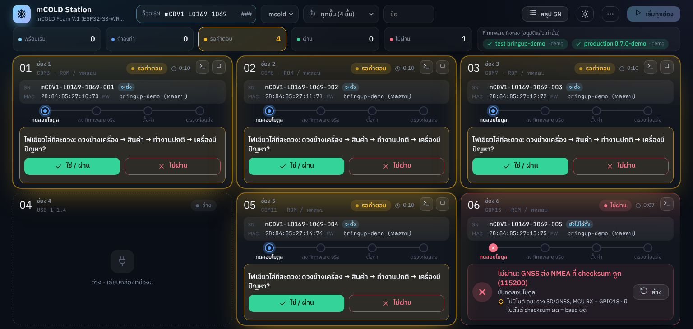

# flasher — สถานี flash / ทดสอบ / ตั้งค่า สำหรับสายผลิต

โปรแกรม `mflash` ใช้ทีละ**ล็อตผลิต** กับกล่องที่**ประกอบเสร็จแล้ว** (ภาคไฟทดสอบมาก่อนประกอบ
เซ็นเซอร์บัดกรีแล้ว ถอดไม่ได้) พากล่องหนึ่งตัว หรือหลายตัวพร้อมกันผ่าน Dock ไปตามลำดับนี้

```
test        ลง bringup แล้วทดสอบทีละโมดูล (I2C, MAX6675, GNSS, LED, buzzer)
  ↓
production  ลบทั้งชิป แล้วลง firmware จริงที่อนุมัติแล้ว ตรวจเวอร์ชันกับ ELF SHA-256
  ↓
setup       SN = ล็อต + เลขเครื่องของช่อง, Wi-Fi, broker, OTA server, ค่าตั้งต้นของ site
  ↓
verify      health ครบ, logtest 14 ข้อ, ไฟ, เสียง, ต่อ broker ได้
```

**ทำไม setup อยู่หลัง production:** bringup ใช้ partition ของ Arduino (`default_16MB.csv`)
ส่วน firmware จริงใช้ `firmware/partitions.csv` ค่าที่ตั้งก่อนวาง partition จริง (และก่อนลบทั้งชิป)
จะหายหรืออยู่ผิดที่ อีกอย่าง firmware จริงมีคำสั่งตั้งค่าครบอยู่แล้ว (`sn set`, `wifi add`,
`mqtt set`, `ota base`, `config set`) จึง**ไม่มี firmware setup แยก**ให้ต้องดูแล

ทุกขั้นมาจาก profile `profiles/mcold.yaml` เงื่อนไขผ่าน/ไม่ผ่านแต่ละข้อเอามาจากโค้ดที่พิมพ์ข้อความนั้นจริง
(`bringup/src/main.cpp`, `firmware/src/main.cpp`) และกับดักใน `firmware/HANDOFF.md` §4
ถูกเขียนเป็นข้อทดสอบ เช่น GNSS ต้องได้ประโยค NMEA ที่ checksum ถูก ไม่ใช่แค่มีไบต์,
เทอร์โมคัปเปิลต้องอ่านได้เป็นตัวเลข (`THERMOCOUPLE OPEN` = โพรบหลุดหรือบัดกรีไม่ติด)
ขั้นทดสอบไม่มีการวัดด้วยมัลติมิเตอร์ ไม่ทดสอบ charger และไม่ถอด/เสียบโพรบ เพราะกล่องประกอบเสร็จแล้ว
คนตอบแค่ 2 ข้อ: ไฟ LED และเสียง buzzer

## ติดตั้ง

Python 3.10 ขึ้นไป

```bash
cd flasher
pip install -r requirements.txt       # esptool, pyserial, PyYAML
python -m mflash --help
```

หรือ `pip install -e flasher` แล้วใช้คำสั่ง `mflash` ได้จากทุกที่
ถ้าจะ build firmware จาก repo ด้วย ต้องมี PlatformIO (`pio`) ด้วย

## หน้าต่าง 6 ช่อง

```bash
python -m mflash gui              # บอร์ดจริงบนบัส USB · เปิดเป็นหน้าต่างของ Edge (app mode)
python -m mflash gui --demo       # บอร์ดจำลอง 5 ตัว ไม่มีอะไรถูก flash จริง: ไว้ฝึกคนและลอง profile
```



### ล็อตและ SN

SN ทั้งล็อตเหมือนกันทุกตัวยกเว้นเลขเครื่องท้าย (`mCDV1-L0169-1069-`**`001`**) จึงกรอก**ล็อต SN**
ครั้งเดียวที่แถบบน (`mCDV1-L0169-1069` ตรวจรูปแบบเดียวกับ firmware) แล้ว:

- แต่ละช่องได้**เลขเครื่อง**ถัดไปที่ยังว่างเอง (ไม่ซ้ำกับที่บันทึกไว้แล้ว และไม่ซ้ำกับช่องอื่น)
  แก้ได้ด้วยการพิมพ์ หรือปุ่ม − / + ที่ข้ามเลขที่ใช้แล้ว
- เลขที่ซ้ำถูกปฏิเสธทันที บอกว่าใครใช้อยู่ (ช่องไหน หรือ SN ของกล่องไหน)
- กล่องที่มี SN อยู่แล้ว (เอามาทำซ้ำ) ใช้ SN เดิม ไม่ได้เลขใหม่
- ไม่ผ่านก่อนถึงขั้นตั้ง SN: เลขนั้นยังว่าง กล่องถัดไปที่เสียบช่องนั้นได้เลขเดิม
- เปลี่ยนล็อต: ทุกช่องที่ยังไม่เริ่มได้เลขใหม่จาก 001 ของล็อตนั้น · ล็อตจำไว้ใน `records/slots.json`

### สรุป SN

ปุ่ม **สรุป SN** แสดงทุกกล่องของล็อต: SN, ผล (ผ่านครบ / ไม่ผ่าน / ยังไม่ครบขั้น), ผลแต่ละขั้น,
ขั้นและข้อที่ไม่ผ่าน, MAC, firmware ที่ลง, เวลาที่เสร็จ, ผู้ทำ และ**เลขเครื่องที่ข้ามไป**
รวมกล่องที่ไม่ผ่านวันนี้ก่อนได้ SN ด้วย · ดาวน์โหลดเป็น CSV ได้ (`SN_<ล็อต>.csv`) หรือจาก command line:

```bash
python -m mflash summary mcold mCDV1-L0169-1069
python -m mflash summary mcold mCDV1-L0169-1069 --csv lot0169.csv
```

### ช่อง

- **ช่องหนึ่ง = ตำแหน่ง USB หนึ่งตำแหน่ง** (ช่องของ Dock หรือสายบนโต๊ะ) ไม่ใช่ COM port
  เพราะบอร์ดเปลี่ยน COM ทุกครั้งที่ restart แต่ตำแหน่งบน hub ไม่เปลี่ยน
  เสียบบอร์ดครั้งแรก ตำแหน่งใหม่จะไปอยู่ช่องว่างแรก · เมนู ⋯ → **บันทึกตำแหน่งช่อง**
  เพื่อให้ช่อง 1–6 ตรงกับช่องจริงของ Dock ทุกครั้งที่เปิดโปรแกรม (`records/slots.json`)
- แต่ละช่องมี 4 ส่วนที่อยู่ที่เดิมเสมอ ไม่บังกัน: หัวช่อง (สถานะ, เวลา, Log, หยุด) ·
  **ข้อมูลกล่อง SN / MAC / FW แสดงค้างไว้ตลอด**ตั้งแต่เสียบจนถอด (SN ที่ยังไม่ได้ตั้งมีป้าย "จะตั้ง") ·
  แถบ 4 ขั้น · และ**พื้นที่ทำงาน**ที่เปลี่ยนตามสถานะ: เลขเครื่อง + ปุ่มเริ่ม / ขั้นที่กำลังทำ /
  คำถามพร้อมปุ่ม ✓ ผ่าน ✗ ไม่ผ่าน / ผ่านทุกขั้น / สาเหตุที่ไม่ผ่านพร้อมคำแนะนำ
- แต่ละช่องทำงานพร้อมกันเป็นอิสระ คำถามขึ้นในช่องนั้นเอง (มีเสียงเตือน, ชื่อหน้าต่างบอกจำนวนช่องที่รอคำตอบ)
- สี: ฟ้า = พร้อม · น้ำเงิน = กำลังทำ · เหลือง = รอคำตอบ · เขียว = ผ่าน · แดง = ไม่ผ่าน
  (พร้อมขั้นที่ไม่ผ่าน, ข้อความจากบอร์ด และคำแนะนำจาก `help:` ใน profile) · แถบบนสุดนับแต่ละสถานะรวมทุกช่อง
- ทุกอย่างอยู่ในกรอบของช่อง ไม่มีแถบเลื่อนในช่อง: จอ 1536×730 ขึ้นไป (เช่น 1920×1080 ที่ขยาย 125%)
  เห็นครบ 6 ช่องในจอเดียวทุกสถานะ · จอเล็กกว่านั้นเลื่อนทั้งหน้าแทน · Log เปิดเป็นหน้าต่างแยก
- ธีมมืดเป็นค่าเริ่มต้น ปุ่ม ☀ มุมขวาบนสลับเป็นธีมสว่างสำหรับห้องที่สว่างมาก (จำไว้ในเครื่อง)
- ผ่าน/ไม่ผ่านแล้ว ถอดบอร์ดออกแล้วเสียบตัวใหม่ ช่องจะกลับเป็น "พร้อม" เอง (หรือกด **ล้าง**)
- **หยุด** มีผลหลังขั้นที่กำลังทำจบ ไม่ตัดกลางการเขียน flash (บอร์ดที่ถูกตัดกลางคันจะค้างใน download mode)
- ใช้เฉพาะ firmware ที่อนุมัติแล้ว แถบบนบอกเวอร์ชันที่จะลง ถ้ายังไม่มีที่อนุมัติ ปุ่มเริ่มจะกดไม่ได้
- หน้าต่างเป็นหน้าเว็บที่ `mflash` เปิดไว้ที่ `127.0.0.1:8765` (มากับ Python ไม่ต้องติดตั้งอะไรเพิ่ม)
  `--host 0.0.0.0` เปิดให้แท็บเล็ตในวงเดียวกันใช้ได้ แต่ทุกคนที่เข้าถึงพอร์ตนี้จะสั่งสถานีได้

## 1. เอา firmware จากโปรเจคเข้าคลัง

สถานีลง firmware จาก**คลัง** (`flasher/library/`, ไม่อยู่ใน git) เท่านั้น ไม่รับไฟล์ที่ผู้ใช้เลือกเอง
ไฟล์ทุกไฟล์ถูกเก็บพร้อม SHA-256 และตรวจซ้ำก่อน flash ทุกครั้ง

```bash
# build จาก git ref ของ repo นี้ (tag, branch, commit) แล้วเก็บเข้าคลัง
python -m mflash fw build mcold production origin/firmware/p7-power
python -m mflash fw build mcold test main            # bringup/

# หรือนำเข้าจากโฟลเดอร์ build ที่มีอยู่แล้ว
python -m mflash fw import mcold production ../firmware/.pio/build/mcold

python -m mflash fw list mcold
python -m mflash fw approve mcold production 0.7.0-dev.61 --by <ชื่อ>
python -m mflash fw approve mcold test <id>
```

- `fw build` checkout ref นั้นแยกไว้ใน `flasher/build/` (ไม่ใช่ temp ของ Windows ที่ path อาจมีช่องว่าง
  ซึ่ง ESP-IDF ไม่ยอม) แล้ว `pio run -e mcold` และ**คัดลอก `secrets.ini` กับ `keys/` จากโปรเจคในเครื่องนี้ไปด้วย**
  เพราะสองอย่างนี้ไม่อยู่ใน git (broker ตั้งต้น, กุญแจเซ็น OTA)
- ตอนนำเข้า โปรแกรมตรวจว่า `partitions.bin` ตรงกับ `firmware/partitions.csv` ทุกแถว
  และ firmware จริงต้องเป็น **0.7.0-dev.5 ขึ้นไป** (`flash`, `sn set`, `ota base` มาพร้อมกันครั้งแรกที่นั่น)
  — **0.6.0 ใช้ไม่ได้** ระหว่างนี้ใช้ branch `firmware/p7-power`
- `fw list` บอกด้วยว่า image เซ็นแล้วหรือยัง (signature block ของ Secure Boot V2 ท้ายไฟล์)

## 2. รัน

```bash
python -m mflash ports                    # มีอะไรบนบัส USB
python -m mflash plan mcold               # ดูว่าจะทำอะไรบ้าง โดยไม่ต้องมีบอร์ด
python -m mflash run mcold all            # ทุกขั้น กับบอร์ดตัวเดียวบนบัส
python -m mflash run mcold verify --all-ports      # ทุกเครื่องบนบัสพร้อมกัน (Dock 6 ช่อง)
python -m mflash run mcold setup,verify --port COM7 --sn mCDV1-L0169-1069-001
```

- ข้อที่ต้องใช้คนดู (ไฟ, เสียง) โปรแกรมจะถามทีละเครื่อง ตอบ `y`/`n`
- รันหลายเครื่อง: เครื่องละ thread แต่ถามคนทีละคำถาม ขึ้นต้นด้วยชื่อช่อง
- เครื่องถูกตามด้วย **MAC และ SN** ไม่ใช่ "พอร์ตล่าสุด" เพราะบอร์ดเปลี่ยนพอร์ตทุกครั้งที่ restart
  (ROM/bringup = PID 1001 serial เป็น MAC · firmware จริง = PID 4003 serial เป็น SN หรือ `MCOLD-xxxx`)
- เข้า download mode เองตามสิ่งที่บอร์ดรันอยู่ (บอร์ดไม่มีปุ่ม BOOT): USB-Serial-JTAG ให้ esptool reset เอง ·
  firmware จริงส่งคำสั่ง `flash` · ROM แบบ USB-OTG reset ด้วย RTC watchdog — ตามที่
  `firmware/tools/usb_flash.py` พิสูจน์ไว้บนบอร์ดแล้ว
- เปิดพอร์ตโดยกด DTR/RTS ไว้ที่ LOW เสมอ ไม่ให้บอร์ด reset ตอนเปิด/ปิดพอร์ต
- ปิด serial monitor ก่อนรัน พอร์ตเปิดได้ทีละโปรแกรม
- **ห้ามใช้ USB isolator** มันทำบอร์ด brownout ตอนมีโหลดกระชาก (HANDOFF §4)

ตัวเลือกสำหรับวิศวกร: `--fw production=<id|version>` เลือก image อื่นที่ไม่ใช่ตัวล่าสุดที่อนุมัติ ·
`--allow-unapproved` ใช้ image ที่ยังไม่อนุมัติ (บันทึกไว้ในประวัติ) · `--yes` ตอบ y ทุกข้อ (bench เท่านั้น)

## 3. ค่าของ site

คัดลอก `site.example.ini` เป็น `site.ini` (ไม่อยู่ใน git) แล้วใส่ Wi-Fi สูงสุด 5 เครือข่าย
(DHCP หรือ IP คงที่), broker, OTA server และ `config set` ที่ต้องการให้ทุกเครื่อง
รหัสผ่านถูกแทนด้วย `****` ในทุกอย่างที่พิมพ์และบันทึก

## 4. บันทึก

ทุก run และทุกขั้นเก็บใน `records/mflash.db` (SQLite, ไม่อยู่ใน git) พร้อมข้อความจาก console
ที่ใช้ตัดสินผล — อ่านย้อนได้โดยไม่ต้องมีบอร์ด

```bash
python -m mflash history                        # run ล่าสุด
python -m mflash history mCDV1-L0169-1069-001   # ของเครื่องเดียว (SN หรือ MAC)
python -m mflash show 42 --output               # ทุกขั้นของ run #42 พร้อมข้อความ
python -m mflash export records.csv             # เครื่องละแถว: SN, MAC, ผลแต่ละขั้น, เวอร์ชัน, ค่า calibration
```

SN ซ้ำกับเครื่องอื่นไม่ได้ (ตรวจกับฐานข้อมูล) และต้องตรงรูปแบบเดียวกับที่ firmware ตรวจ
(`sn_pattern_ok()` ใน `logrow.cpp`)

## 5. ซ่อม / เครื่องที่ส่งกลับมา

```bash
python -m mflash backup mcold --port COM7       # อ่าน nvs, log_meta, trip_log, coredump ออกมาก่อน
```

เก็บที่ `backups/<SN>/` ก่อน reflash เสมอ เพราะ `production` ลบทั้งชิป

## eTEMP และสินค้าอื่น

สินค้าหนึ่งตัว = ไฟล์ profile หนึ่งไฟล์ใน `profiles/` ไม่ต้องแก้โค้ด
`profiles/etemp.yaml` เป็นแม่แบบที่ยังไม่ครบ (ใน repo นี้ไม่มีข้อมูลฮาร์ดแวร์ของ eTEMP)
โปรแกรมจะไม่ยอมรันจนกว่ารายการ `incomplete:` ในไฟล์จะว่าง สิ่งที่ต้องรู้:
ชิปรุ่นไหน, USB native หรือชิป USB-UART (VID/PID, มีวงจร auto-reset ไหม),
firmware อยู่ที่ไหนและ build อย่างไร, มีคำสั่ง console ไหม, รูปแบบ SN, partition layout

## ชนิดของขั้น (สำหรับเขียน profile)

| type | ทำอะไร |
|---|---|
| `confirm` | (ส่ง `send` ก่อนถ้ามี) แล้วถามคน `ask` y/n |
| `console` | ส่ง `send`, ผ่านเมื่อตรงทุก `expect` และไม่ตรง `forbid` ใด ๆ · `until` รอจนเจอข้อความนี้ (คำสั่งที่นาน) |
| `chip` | esptool อ่าน MAC, revision, flash size เทียบ `chip_expect` |
| `flash` | ลง `firmware` จากคลัง (`erase: true` ลบทั้งชิปก่อน) แล้วรอ console กลับมา |
| `version` | `version` ของบอร์ดต้องตรงกับ image: เวอร์ชันและ ELF SHA-256 |
| `health` | ตาราง `health` ทุกอุปกรณ์ต้อง `ok` ยกเว้นที่ระบุใน `states` · `temperature`, `clock_usable` |
| `nmea` | นับประโยค NMEA ที่ checksum ถูก ต้องได้อย่างน้อย `min_good` |
| `input_sn` / `set_sn` | SN จากล็อต + เลขเครื่องของช่อง (หน้าต่าง) หรือ `--sn` หรือถาม, ตรวจรูปแบบและไม่ซ้ำ, กล่องที่มี SN แล้วใช้ SN เดิม, `sn set`, reboot, อ่านกลับ |
| `provision` | Wi-Fi, broker, OTA base, config จาก `site.ini` |
| `calibrate` | สอบเทียบ 1 จุดกับเทอร์โมมิเตอร์อ้างอิง (**ปิดไว้** จนกว่าจะลองกับบอร์ดจริง) |
| `reboot`, `note` | |

ทุกขั้นมี `optional` (ไม่ผ่านก็ไปต่อ), `enabled: false`, `retries` / `retry_wait`
และ `help` (ข้อความบอกสาเหตุที่น่าจะเป็นเมื่อไม่ผ่าน)

## สถานะ

**ยังไม่ได้รันกับบอร์ดจริง** ที่ทดสอบแล้ว (`python -m pytest`, 29 ข้อ):

- ทุกขั้นตั้งแต่ test จนถึง verify กับบอร์ดจำลอง (`tests/fakes.py`) ที่ทำตัวตามที่วัดจากบอร์ดจริง:
  เปลี่ยนพอร์ต/PID/serial ตาม firmware ที่รัน, `flash` เข้า ROM, `sn set` มีผลหลัง reboot
- การอ่าน app descriptor (ตรงกับที่ `esptool image-info` อ่านได้) และ partition table เทียบกับ `partitions.csv`
- คลัง: นำเข้า, อนุมัติ, ไฟล์ถูกแก้หลังนำเข้า, partition ผิด, เวอร์ชันเก่าเกิน, `fw build` จาก git
- คำสั่ง esptool ทุกแบบที่ใช้ parse ผ่านกับ esptool 5.6 (ทดสอบกับพอร์ตที่ไม่มีอยู่)
- หน้าต่าง: 5 ช่องพร้อมกัน, ตอบ "ไม่ผ่าน", หยุดระหว่างรอคำตอบ, ถอด/เสียบบอร์ดใหม่, บันทึกตำแหน่งช่อง,
  ล็อตและเลขเครื่อง (เลขซ้ำถูกปฏิเสธ, เลขว่างถัดไป, SN เดิมของกล่องที่ทำซ้ำ), สรุป SN และ CSV,
  HTTP API ทุกคำสั่ง · เปิดหน้าจริงใน Chromium (Playwright) กดเริ่มทุกช่อง ตอบทุกข้อจนจบ
  แล้ววัดที่ 6 ขนาดจอว่าไม่มีอะไรล้นกรอบช่อง และ SN/MAC/FW ไม่ถูกซ่อนในสถานะใดเลย

ต้องลองกับบอร์ดจริงก่อนใช้ในสายผลิต: รูปแบบผลของ `esptool flash_id` กับชิปจริง, จังหวะเวลาของ
`logtest`/`ledtest`/`sync`, ข้อความของ bringup `power` ตอนชาร์จ, การรันพร้อมกัน 6 เครื่องผ่าน Dock,
และ USB location ที่ Windows รายงาน (ใช้ผูกช่อง) ว่าคงที่จริงเมื่อบอร์ดเปลี่ยนจาก ROM เป็น firmware

## โครงสร้าง

```
mflash/
  cli.py        คำสั่งทั้งหมด
  runner.py     รันขั้นตอนของ profile กับบอร์ดหนึ่งตัว, ตามบอร์ดข้าม restart
  esp.py        esptool และการเข้า download mode
  ports.py      หาบอร์ดบนบัส USB จาก VID/PID/serial
  console.py    console ของบอร์ด (DTR/RTS low, อ่านจนเงียบ)
  firmware.py   คลัง firmware: build จาก git, นำเข้า, อนุมัติ, ตรวจ SHA-256
  imageinfo.py  อ่าน app descriptor และ partition table จากไฟล์
  parsers.py    อ่านผลของ health / version / NMEA
  db.py         บันทึก SQLite
  site.py       site.ini
  ui.py         คุยกับคนที่สถานี (terminal)
  station.py    หน้าต่าง 6 ช่อง: ช่อง ↔ ตำแหน่ง USB, thread ต่อช่อง, คำถาม/คำตอบ, หยุด
  gui.py        เว็บเซิร์ฟเวอร์ของหน้าต่าง (standard library) · gui.html หน้าต่างเอง
  sim.py        บอร์ดจำลองสำหรับ test และ --demo
profiles/       mcold.yaml, etemp.yaml
docs/           ภาพหน้าต่าง
tests/          บอร์ดจำลองและ test
```
