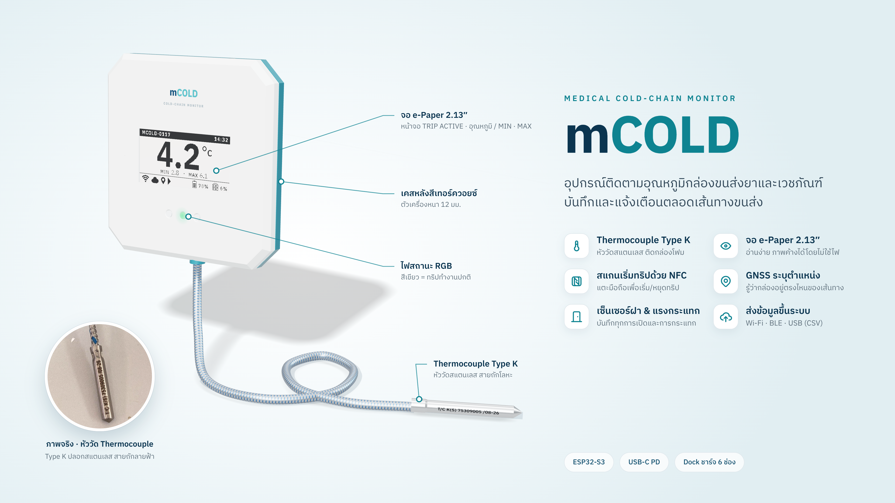

# mockup

ภาพ mock-up นำเสนอสินค้า เรนเดอร์จากโมเดล 3D จริงของเคส
(`Assy CASE_80CM_V2x.STEP` ที่อยู่ใน `../Assy CASE_80CM_V2x.rar`)



- `out/mCOLD_mockup.png`: 3840×2160 (16:9) ใช้ในสไลด์ได้ทันที
- จอ e-paper คือ state A2 TRIP ACTIVE ที่ดึงมาจาก `../display-mock/out/A2_trip.png`
  ถ้าแก้ layout จอแล้วให้รัน `prepare.py` ใหม่ ภาพจะตามไปเอง
- thermocouple ในฉากจำลองจากหัววัดจริง (สายถักลายฟ้า ปลอกสแตนเลส ข้อความ laser
  `T/C K(S) 75309005 /08-26`) ส่วนวงกลมมุมซ้ายล่างคือภาพถ่ายจริง `assets/thermocouple.jpg`
- สีใช้ชุดเดียวกับ `../mcold-spec/template.html` (navy `#0b3550`, teal `#0e8391`)
  และฟอนต์ IBM Plex Sans Thai จาก `../mcold-spec/fonts`
- เคสหน้าสีขาว เคสหลังสี teal และไฟ LED กลางสีเขียว (ทริปทำงานปกติตาม `docs/led-design.md`)
  เป็นสีสำหรับนำเสนอ ไม่ใช่สีผลิตจริง

## สร้างภาพใหม่

```bash
pip install cadquery-ocp trimesh pillow scipy rtree
bsdtar -xf "Assy CASE_80CM_V2x.rar" -C /tmp          # หรือแตกด้วย WinRAR / 7-Zip
python mockup/prepare.py "/tmp/Assy CASE_80CM_V2x.STEP" # -> mockup/build/ (STL รายชิ้น + texture จอ)
cd mockup && npm install && node render.js              # -> out/mCOLD_mockup.png
```

`render.js` ใช้ Playwright + Chromium (WebGL ผ่าน SwiftShader) เปิด `hero.html`
แล้ว screenshot ที่ 2× · มุมกล้อง, การหมุนหัววัด และตำแหน่งภาพถ่ายปรับได้ผ่าน query
string โดยไม่ต้องแก้โค้ด เช่น `hero.html?cam=[100,135,480,30,-42,12]&pr=4.71&ins=[96,690]`

พิกัดที่วัดจาก STEP (หน่วย mm ตามแกนของไฟล์):
เคส 87 × 87 × 12 · หน้าเครื่องคือ +Z (ชิ้น `Main Case_BOT`) ·
ช่องจอ x −45.5…2.5, y −5.7…17.3 (48 × 23 ตรงกับ active area ของจอ 2.13″) ·
light pipe หน้า 3 ดวงที่ y −18.2 · ไฟข้างอยู่ขอบบน
