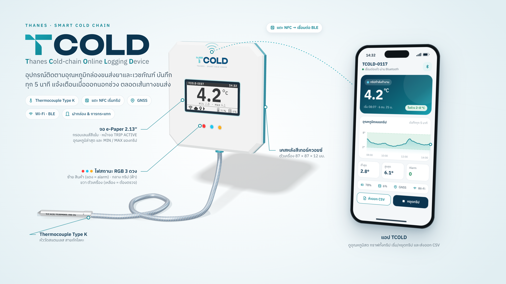
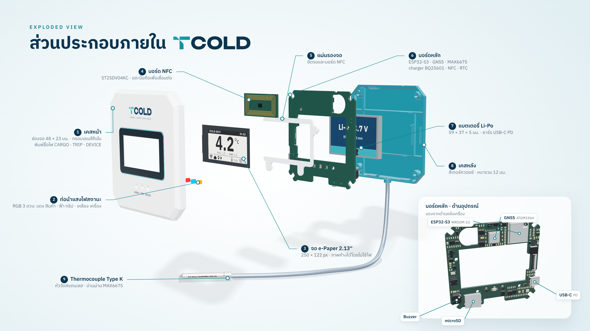

# mockup

ภาพนำเสนอสินค้า **TCOLD** (ชื่อเดิมของโปรเจกต์คือ mCOLD) เรนเดอร์จากโมเดล 3D จริงของเคส
(`Assy CASE_80CM_V2x.STEP` ที่อยู่ใน `../Assy CASE_80CM_V2x.rar`)

## ชื่อและโลโก้

**TCOLD — Thanes Cold-chain Online Logging Device**
อักษรแรกของแต่ละคำประกอบเป็น T·C·O·L·D และอยู่ในสาย *Smart Cold Chain* ของ THANES

- ตัว T เอามาจากโลโก้ THANES (วัดจากภาพถ่ายแล้วสร้างใหม่เป็น vector): T ที่ถูกตัดด้วยเส้นทแยง
  45° เส้นเดียวผ่านแขนซ้ายและหัวก้าน มุมที่เส้นตัดชนขอบมีความโค้ง ครึ่งขวาของคานไม่ถูกตัด
- COLD ใช้ฟอนต์ Unbounded Bold (OFL) แปลงเป็นเส้นแล้ว ไฟล์ SVG จึงไม่ต้องติดตั้งฟอนต์
  เลือก Bold เพราะความหนาเส้นใกล้ T มากที่สุด
- ชื่อเต็มใช้ IBM Plex Sans ใกล้กับแถว "Smart Cold Chain · Smart Lab …" ในโลโก้ THANES
- ไฟล์อยู่ใน `brand/` สร้างใหม่ด้วย `python mockup/brand/logo.py`

| ไฟล์ | ใช้กับ |
|---|---|
| `TCOLD_logo.svg` | พื้นสว่าง (T teal ไล่สี, COLD navy) |
| `TCOLD_logo_on_dark.svg` | พื้นเข้ม (T teal, COLD ขาว) |
| `TCOLD_logo_white.svg` / `TCOLD_logo_navy.svg` | สีเดียว |
| `TCOLD_lockup.svg` / `TCOLD_lockup_on_dark.svg` | โลโก้ + ชื่อเต็ม |

## ภาพสไลด์สำเร็จ

| ไฟล์ | หน้า | เนื้อหา |
|---|---|---|
| `out/TCOLD_mockup.png` | `hero.html` | ตัวเครื่อง + thermocouple + แอปบนมือถือ |
| `out/TCOLD_explode.png` | `explode.html` | exploded view 9 ชิ้น พร้อมภาพบอร์ดหลักด้านอุปกรณ์ |




ทั้งสองภาพขนาด 3840×2160 (16:9)

## โลโก้ TCOLD DOCK Station (`out/TCOLD_DOCK_STATION_logo_board.png`)

สร้างด้วย `python mockup/brand/dock_logo.py` ต่อยอดจากโลโก้ TCOLD: ตัว T จาก THANES, DOCK เป็น
Unbounded Bold เหมือน COLD, STATION เป็น Unbounded Regular ระยะห่างตัวอักษรกว้าง

| ไฟล์ (`brand/`) | ใช้กับ |
|---|---|
| `TCOLD_DOCK_STATION_logo.svg` / `_on_dark.svg` | หลัก แนวนอน: TCOLD │ DOCK / STATION |
| `TCOLD_DOCK_STATION_stacked.svg` / `_on_dark.svg` | แนวตั้ง: TCOLD เหนือ DOCK · STATION |
| `TCOLD_DOCK_STATION_symbol.svg` | ไอคอนพื้น navy มุมโค้ง: ตัว T เหนือ Dock ที่มี TCOLD 6 เครื่อง จุดเขียว = ไฟชาร์จ |
| `TCOLD_DOCK_STATION_symbol_on_light.svg` | symbol พื้นใส สำหรับพื้นสว่าง |

PNG กว้าง 2400 px อยู่ใน `out/objects/` บอร์ดโลโก้วาดด้วย `brand_dock.html`
ด้านหน้า Dock ในภาพ 3D ใช้โลโก้แนวนอนพื้นเข้ม

## TCOLD Dock (`out/TCOLD_dock.png`, หน้า `dock.html`)

แท่นชาร์จ 6 ช่องจาก `../Dock Assy.rar` (Dock Assy.STEP) พร้อม TCOLD 6 เครื่องเสียบอยู่

- เครื่องยืนบนขอบซ้าย (ด้านที่มีพอร์ต USB-C) ขั้ว USB-C ของแต่ละช่องอยู่ที่ Z 58–67.5 บนพื้นช่อง Y −6.3
  ช่องกว้าง 14 มม. ห่างกัน 20 มม. (วัดจาก STEP) ตำแหน่งเครื่องคำนวณใน `scene.js` (`seat()`)
- สี Dock: ตัวกล่อง navy `#0b3550` ตัดกับเครื่องสีขาว ฐานสี teal `#0e8391` เข้าชุดกับฝาหลังเครื่อง
  โลโก้ TCOLD DOCK ด้านหน้า (สีและโลโก้สำหรับนำเสนอ ไม่มีในไฟล์ STEP)
- จอแต่ละเครื่องแสดงหน้า CHARGING (รหัส TCOLD-0117 ถึง 0122, % แบตต่างกัน) ไฟข้างเครื่องเขียว
- สเปกจาก `../README.md` (ตาราง hardware) และหัวข้อ 6 ของ `../docs/mCOLD_Firmware_Requirements_2026-09-19.md`
  ขนาด 164.5 × 119.4 × 59.4 มม. วัดจาก STEP

สร้างใหม่: `python mockup/prepare.py --dock "Dock Assy.STEP"` แล้ว `python mockup/objects.py`
และ `node mockup/render.js '[["dock.html","out/TCOLD_dock.png",1920,1080,2]]'`

## สไลด์นำเสนอ (`out/TCOLD_presentation.pptx`)

ร่าง 20 สไลด์ 16:9 แบ่ง 3 section: **หน้าตาโปรดักต์ · FUNCTION · SPECIFICATION**
วางเนื้อหาและรูปไว้ครบบนธีมเรียบ (ปก/คั่น section สี navy, เนื้อหาพื้นขาว) ข้อความใช้ฟอนต์ของธีม
(Leelawadee UI) เท่านั้น เมื่อคัดลอกสไลด์ไปวางในเทมเพลตของบริษัทแบบ "Use Destination Theme"
ข้อความจะเปลี่ยนเป็นฟอนต์ของเทมเพลตเอง กราฟการแจ้งเตือนเป็นกราฟ PowerPoint แก้ตัวเลขได้
แต่ละสไลด์มี speaker notes

สร้างใหม่ด้วย `python mockup/objects.py` แล้ว `node mockup/deck/build.js`
ภาพเครื่องในแต่ละสถานะ (`state_*.png`) ใช้หน้าจอจาก `prepare.py --screens`

## ชิ้นงานแยก (PNG พื้นใส) สำหรับวางบนธีมสไลด์

`out/objects/` ตัดขอบให้พอดีชิ้นแล้ว ไม่มีพื้นหลัง ไม่มีป้ายชี้ ทุกชิ้นมีเงานุ่มสี navy
(แบบเดียวกับเงามือถือ) เพื่อให้เห็นบนสไลด์พื้นขาว ยกเว้นไฟล์โลโก้

| ไฟล์ | เนื้อหา |
|---|---|
| `TCOLD_logo*.png`, `TCOLD_lockup*.png` | โลโก้กว้าง 2400 px |
| `device_with_probe.png` | ตัวเครื่องมุมเดียวกับสไลด์หลัก พร้อมสายและหัววัด |
| `device_front.png` / `device_back.png` | ตัวเครื่องตรงหน้า / ด้านหลัง |
| `phone_app.png` / `phone_app_tilted.png` | มือถือพร้อมหน้าจอแอป ตรง / เอียง |
| `explode_stack.png` | ชุด explode ทั้งชุด ไม่มีป้าย |
| `part_1_front_case.png` … `part_8b_back_case_outside.png` | แต่ละชิ้นในมุมเดียวกับ explode ใช้เรียงเองในสไลด์ได้ (6b = บอร์ดหลักด้านอุปกรณ์, 8b = ฝาหลังด้านนอก) |
| `thermocouple.png` | สายและหัววัด |
| `epaper_screen_trip.png` | ภาพหน้าจอ e-paper TRIP ACTIVE |
| `dock_with_6.png`, `dock_front.png`, `dock_back.png`, `dock_top.png`, `dock_empty.png` | Dock พร้อมเครื่อง 6 เครื่อง (มุมเฉียง / หน้า / หลังเห็นพอร์ต / บน) และ Dock เปล่า |
| `dock_dimensions_*.png` | ภาพขนาด Dock ด้านหน้าและด้านข้าง |
| `state_A1_ready` … `state_C1_summary.png` | ตัวเครื่องในแต่ละสถานะ: READY, TRIP, นอกช่วง, ALARM, สรุปทริป พร้อมไฟที่ติดตามสถานะนั้น |

### สเปกเครื่อง (`out/objects/spec/`, หน้า `spec.html`)

ทุกชิ้นมีทั้ง `_light` (การ์ดขาว) และ `_dark` (การ์ด navy) พื้นนอกการ์ดใส

| ไฟล์ | เนื้อหา |
|---|---|
| `spec_sheet_*.png` | สเปกทั้งหมดในแผ่นเดียว พร้อมภาพขนาดตัวเครื่อง โลโก้ และหมายเหตุ |
| `spec_card_temp/body/sense/link/data/power_*.png` | การ์ดแยกหมวด: การวัดอุณหภูมิ, ตัวเครื่อง, การติดตาม, การเชื่อมต่อ, การเก็บข้อมูล, พลังงาน |
| `spec_kpi_1…6_*.png` | ตัวเลขเด่น: 0.25 °C, 5 นาที, ~268 วัน, 7 วัน, 87×87×12.3 มม., 2.13″ |
| `spec_card_dock_*.png`, `spec_kpi_7…9_dock_*.png` | การ์ดสเปก Dock และตัวเลขเด่น (6 ช่อง, 1 สาย, 45 W) |
| `spec_dimensions_*.png` | ภาพขนาดด้านหน้าและด้านข้าง วาดแบบ orthographic จาก STEP (7 px ต่อ มม. ที่ 1×) มีสำเนาที่ `out/objects/device_dimensions_*.png` |

ตัวเลขทุกตัวมาจากเอกสารใน repo: `README.md`, `docs/mCOLD_Firmware_Requirements_2026-09-19.md`,
`docs/manuals/user-manual-th.md`, `docs/app/device-settings.md` และขนาดวัดจาก STEP
ค่าที่ติดป้าย **เป้าหมาย** (แบต 1500 mAh, ใช้งาน 7 วัน) ยังไม่ได้วัดจริงบนต้นแบบ
ความละเอียด 0.25 °C ของ MAX6675 ไม่ใช่ความแม่นยำ และ MAX6675 อ่านค่าติดลบไม่ได้ จึงเขียนช่วงวัดว่า "0 °C ขึ้นไป"

## หมายเหตุ

- จอ e-paper คือ state A2 TRIP ACTIVE วาดด้วย `../display-mock/render.py` โดยเปลี่ยนรหัสเครื่องเป็น TCOLD-0117
  มีกรอบเลนส์สีเข้มกว้าง 1.6 มม. รอบช่องจอ (กรอบนี้เป็นสีสำหรับนำเสนอ ไม่มีในไฟล์ STEP)
- ไฟหน้า 3 ดวงติดทุกดวงเพื่อให้เห็นสีประจำตำแหน่งตาม `../docs/led-design.md`:
  ซ้าย CARGO แดง · กลาง TRIP ฟ้า · ขวา DEVICE เหลือง เป็นสีทึบ ไม่มีแสงฟุ้ง ไม่มีตัวหนังสือใต้ไฟ
  ตอนใช้งานจริงไฟติดเป็นจังหวะตามเหตุการณ์ ไม่ได้ติดพร้อมกัน
- หน้าจอแอปในมือถือเป็นภาพแนวคิด (`phone.js`) ไม่ใช่ภาพจากเดโมแอป
  ตัวเลขทุกตัวตรงกับหน้าจอ e-paper ส่วนช่วง 2–8 °C และปุ่มต่าง ๆ อิงคู่มือ
  `../docs/manuals/user-manual-th.md`
- thermocouple จำลองจากหัววัดจริง (สายถักลายฟ้า ปลอกสแตนเลส ข้อความ laser
  `T/C K(S) 75309005 /08-26`)
- ใน STEP บอร์ดหลักเป็นพื้นผิว 2,148 ชิ้นที่ไม่มีข้อมูลสี `prepare.py` จึงจัดกลุ่มตามขนาด
  (บอร์ด, shield โลหะ, ขา/pad, passive, ชิปดำ) เพื่อลงสี ป้ายชิ้นส่วนในภาพบอร์ด
  ชี้ตามขนาด footprint ที่ตรงกับ datasheet (ESP32-S3-WROOM-1U 18 × 19.2, ATGM336H 10.1 × 9.7)
- สีเคส (หน้าขาว หลัง teal) และโลโก้บนหน้าเครื่องเป็นสีสำหรับนำเสนอ ไม่ใช่สีผลิตจริง
- สีและฟอนต์ใช้ชุดเดียวกับ `../mcold-spec/template.html`

## สร้างภาพใหม่

```bash
pip install cadquery-ocp trimesh pillow scipy rtree
bsdtar -xf "Assy CASE_80CM_V2x.rar" -C /tmp          # หรือแตกด้วย WinRAR / 7-Zip
python mockup/prepare.py "/tmp/Assy CASE_80CM_V2x.STEP" # -> mockup/build/ (STL รายชิ้น + texture จอ)
cd mockup && npm install
python brand/logo.py                                     # โลโก้ SVG
node render.js '[["hero.html","out/TCOLD_mockup.png",1920,1080,2],["explode.html","out/TCOLD_explode.png",1920,1080,2]]'
python objects.py                                         # ชิ้นงานแยก -> out/objects/
```

`render.js` ใช้ Playwright + Chromium (WebGL ผ่าน SwiftShader) เปิดหน้าแล้ว screenshot ที่ 2×
ส่วนที่ทั้งสองหน้าใช้ร่วมกัน (โหลดชิ้นงาน, วัสดุ, จอ, กรอบ, ไฟ, thermocouple, ป้ายชี้) อยู่ใน `scene.js`

ปรับได้ผ่าน query string โดยไม่ต้องแก้โค้ด เช่น
- `hero.html?cam=[60,135,520,23,-40,12]&ph=[1330,170]&pr=4.71`: มุมกล้อง, ตำแหน่งมือถือ, การหมุนหัววัด
- `explode.html?dz={"top":0,"battery":40,...}&rot=[-0.1,-0.85,0]&lab={"5":[1000,170,"r"]}`:
  ระยะแยกชิ้น, มุมหมุนทั้งชุด, ตำแหน่งป้ายชิ้นที่ 1–9

พิกัดที่วัดจาก STEP (หน่วย mm ตามแกนของไฟล์):
เคส 87 × 87 × 12 · หน้าเครื่องคือ +Z (ชิ้น `Main Case_BOT`) ·
ช่องจอ x −45.5…2.5, y −5.7…17.3 (48 × 23 ตรงกับ active area ของจอ 2.13″) ·
light pipe หน้า 3 ดวงที่ y −18.2 · ไฟข้างอยู่ขอบบน · บอร์ดหลักหนา 1.6 อุปกรณ์อยู่ด้านหลัง
และมีช่องเจาะให้แบต
